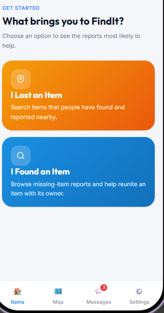
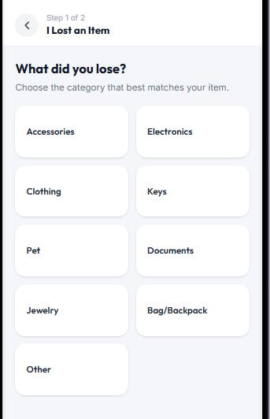
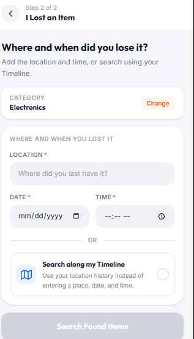
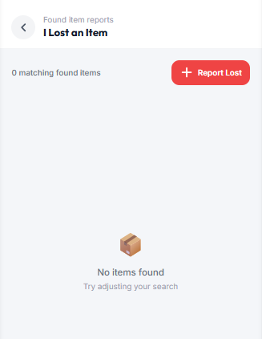
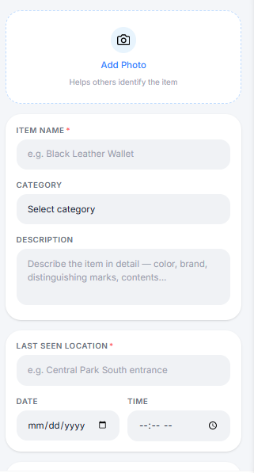
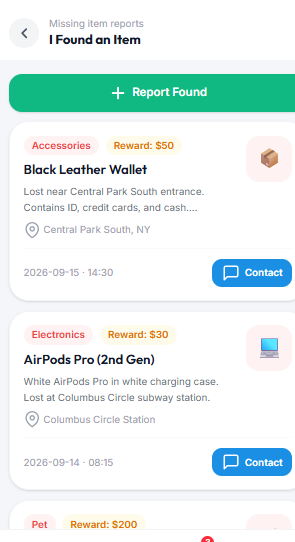
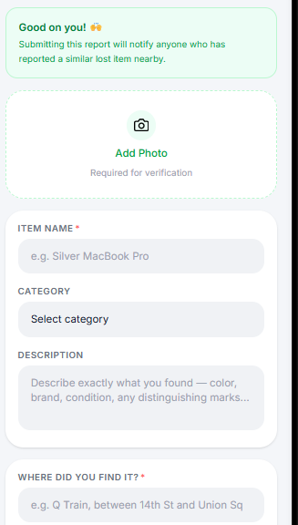
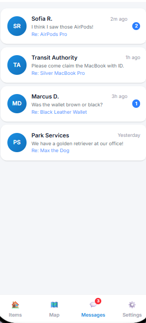
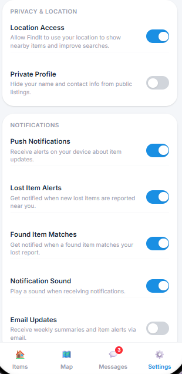

# UI Specification

Prototype: [FindIt on Figma Make](https://www.figma.com/make/xAdooMkvHAB9Gca39tmvnG/Lost-and-Found-App?p=f).
Exported screens live in [`screens/`](screens/) and are the offline reference when the
prototype is unreachable. **The prototype supersedes the Task Scenario and Iteration Plan
documents wherever they disagree** — in particular, there is no longer a loser/finder
toggle at the bottom of the home screen.

## Shell

Mobile-first, ~390 px design width, single column, safe-area padded. A persistent bottom
tab bar with four destinations is present on top-level screens:

| Tab | Contents |
| --- | --- |
| **Items** | Home, both report flows, search results. Default tab. |
| **Map** | Map view of reports. |
| **Messages** | Conversation list. Shows an unread-count badge (red pill, e.g. `3`). |
| **Settings** | Privacy, location, and notification toggles. |

Flow screens (category picker, where/when, forms) are pushed on top of the tab and carry
a header with a circular back chevron, a small grey breadcrumb line, and a bold title —
e.g. breadcrumb `Step 1 of 2` over title `I Lost an Item`, or breadcrumb
`Missing item reports` over `I Found an Item`.

## Design tokens

| Token | Value | Used for |
| --- | --- | --- |
| Lost / primary accent | orange gradient `#F59E0B → #EA580C` | "I Lost an Item" card, `Change` chip |
| Found / secondary accent | blue gradient `#3B82F6 → #1D4ED8` | "I Found an Item" card, `Contact` buttons |
| Success | green `#10B981` | `Report Found` CTA, found-report banner |
| Danger / action | red `#EF4444` | `Report Lost` CTA, unread badge, required `*` |
| Surface | white `#FFFFFF` on page `#F3F4F6` | Cards, inputs |
| Text | `#111827` primary, `#6B7280` secondary | |
| Radius | 12 px cards and inputs, 16 px feature cards, pill for chips | |

Section headings are uppercase, letter-spaced, and secondary-colored (`GET STARTED`,
`WHERE AND WHEN YOU LOST IT`, `PRIVACY & LOCATION`, `NOTIFICATIONS`).

## Screens

### Home — "What brings you to FindIt?"
Two full-width gradient cards, each with an icon tile, bold title, and one line of
supporting copy. **I Lost an Item** (orange, pin icon) — "Search items that people have
found and reported nearby." **I Found an Item** (blue, magnifier icon) — "Browse
missing-item reports and help reunite an item with its owner." These replace the old
bottom-tab side switcher; they are navigation into two distinct flows.

### Lost, step 1 — category

Two-column grid of white cards: Accessories, Electronics, Clothing, Keys, Pet, Documents,
Jewelry, Bag/Backpack, Other. Selecting one advances immediately. This exact list is the
canonical `category` vocabulary; backend and seed data must match it.

### Lost, step 2 — where and when

A read-only `CATEGORY` card showing the step-1 choice with an orange `Change` chip that
returns to step 1. Below it, a `WHERE AND WHEN YOU LOST IT` card with **Location\***
(placeholder "Where did you last have it?", Google Places autocomplete), **Date\*** and
**Time\***. An `OR` divider separates the alternative: a **Search along my Timeline**
radio option — "Use your location history instead of entering a place, date, and time."

The primary button reads **Search Found Items** and stays disabled until either the
location/date/time group is complete or Timeline is selected. Selecting Timeline disables
the manual fields, and vice versa.

### Lost — results

Header `Found item reports / I Lost an Item`. A count line (`0 matching found items`)
sits left of a red **+ Report Lost** button. Empty state is a box illustration with
"No items found" and "Try adjusting your search". Result cards use the same anatomy as
the finder list below, minus the reward chip.

### Report Lost form

Dashed **Add Photo** dropzone labelled "Helps others identify the item" — optional here.
Then `ITEM NAME*`, `CATEGORY` (select), `DESCRIPTION` ("Describe the item in detail —
color, brand, distinguishing marks, contents…"), `LAST SEEN LOCATION*`, `DATE`, `TIME`.
Fields must be prefilled from the step-2 search when the user arrives from results.

### Found — missing-item reports

A full-width green **+ Report Found** button pinned above the list. Each card shows: a
category chip and an amber `Reward: $50` chip, the item title, two lines of truncated
description, a pin icon with the location text, the event timestamp
(`2026-09-15 · 14:30`), a thumbnail, and a blue **Contact** button that opens the chat
thread for that item. Cards expose only non-identifying detail — precise location and
secondary photo are withheld, per [security.md](../security.md).

### Report Found form

Opens with a green reassurance banner: "Good on you! 🙌 Submitting this report will notify
anyone who has reported a similar lost item nearby." The **Add Photo** dropzone here is
labelled "Required for verification" and is mandatory. Fields: `ITEM NAME*`, `CATEGORY`,
`DESCRIPTION` ("Describe exactly what you found — color, brand, condition, any
distinguishing marks…"), `WHERE DID YOU FIND IT?*`.

### Messages

Rows of circular initial avatars, sender name, relative time (`2m ago`, `Yesterday`),
one-line message preview, a blue `Re: <item title>` context line, and a blue unread count
badge. Messages is its own tab, not a sub-view of either side.

### Settings

Grouped toggle rows, each with a label and one explanatory line. **Privacy & Location**:
Location Access (on), Private Profile (off). **Notifications**: Push Notifications,
Lost Item Alerts, Found Item Matches, Notification Sound (all on), Email Updates (off).
Defaults shown are the intended defaults.

## Interaction rules

- Required fields are marked with a red `*`; the submit button is disabled, not
  error-popped, until the form is valid.
- Validation and auth failures render inline next to the field or as an in-page banner.
  **No `window.alert` / `confirm`** — the existing code uses them and must be migrated.
- Every list has a defined empty state; every network call has a loading state.
- Touch targets are at least 44×44 px, since this ships as an iOS app via Capacitor.
